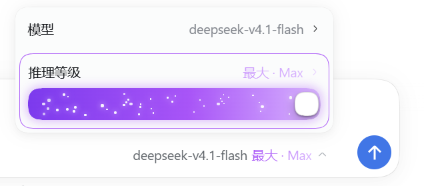

# DSH 推理等级滑条

在 DeepSeek Harness 官方模型菜单里，用 Codex 风格的滑条设置推理等级。

保留官方「推理等级」切换行，不替换原有选择逻辑；在同一个描边容器内加入可拖动轨道，拖动时实时预览，松手后提交。选择完成后，输入框模型名称后面的推理等级文字也会同步变色。

<p align="center">
  
</p>

<p align="center"><sub>Max 档位：官方切换行与滑条共用同一容器，模型选择器后的「最大 · Max」同步为紫色。</sub></p>

## 功能

- **嵌入官方菜单**：滑条出现在官方「推理等级」行内，不额外增加设置页或独立面板。
- **保留官方切换**：官方等级行仍然可见、可点击，滑条只作为更快的拖动入口。
- **任意档位数量**：不假定固定 4 档，4、5、6 档等模型都按首档到末档等距映射。
- **拖动提交**：按住滑块拖动时只更新预览，松手后才调用官方接口切换等级。
- **点击跳档**：点击轨道上的任意位置可直接跳到对应档位。
- **键盘操作**：`←` / `↓` 降档，`→` / `↑` 升档，`Home` 回到首档，`End` 跳到末档。
- **进度跟随滑块**：填充宽度根据当前档位计算，不是始终填满；只有末档才铺满整条轨道。
- **颜色随档位变化**：默认灰色，低档蓝色，高档蓝紫渐变，最高档紫色渐变。
- **克制的光效**：外层是实线描边，只有高档和最高档的轨道带轻微模糊外发光。
- **星尘动画**：白色粒子水平从左向右流动，档位越高数量越多、速度越快；无流光扫带。
- **白色圆形滑块**：24px 白色圆形拨片配合胶囊形轨道，贴合当前 DSH 菜单视觉。
- **触发器同步变色**：模型选择器后的等级文字与滑条状态使用同一套颜色。
- **自动降级**：当前模型没有推理档位、或官方菜单结构不匹配时，不插入滑条，不影响原菜单使用。
- **减少动态效果**：遵循 `prefers-reduced-motion`，系统开启减少动态效果时关闭粒子动画。

## 环境要求

- 已安装 DeepSeek Harness Desktop。
- 当前模型在 DSH 中声明了 `reasoning.efforts` 档位。
- 插件以 DSH bundle 形式加载，不需要单独启动服务。

## 安装

发布到 npm 后，可以直接通过 DSH CLI 安装：

```bash
dsh plugin --profile desktop add dsh-codex-reasoning-slider
```

`desktop` 是 DSH Desktop 的 profile 名称；使用其他 profile 时替换成对应名称。安装完成后，完全退出并重新打开 DSH Desktop。

也可以在支持自定义 NPM 安装的插件市场中填写包名 `dsh-codex-reasoning-slider`。

### 从本地目录安装

开发阶段可以在 DSH 中进入 **设置 → 插件 → 添加插件**，选择本仓库根目录，也就是包含 `package.json` 的那一层。也可以使用：

```bash
dsh plugin --profile desktop add <本仓库绝对路径>
```

插件包名为 `dsh-codex-reasoning-slider`。

> 修改 `client.js` 后同样需要完全重启 DSH Desktop，浏览器端代码不会在已打开的窗口中热更新。

## 使用

1. 打开输入框里的模型选择菜单。
2. 找到「推理等级」行，按住滑条拖动，或直接点击目标位置。
3. 松手后立即提交到当前模型；键盘操作会直接切换。
4. 关闭菜单后，输入框中的模型名称后面会显示同步变色后的等级文字。

## 档位与视觉

插件根据当前模型返回的档位列表动态生成刻度，位置按下面的比例计算：

```text
ratio = 当前档位索引 / (档位总数 - 1)
```

| 档位 | 轨道表现 |
| --- | --- |
| 首档 / 关闭 | 灰色，不显示彩色填充 |
| 中间低档 | 蓝色纯色填充，无外发光 |
| 中间高档 | 蓝紫渐变，紫色描边与轻微光晕 |
| 末档 | 紫色渐变并填满轨道，紫色描边与轻微光晕 |

白色刻度点始终显示在填充层上方，作为档位参考。

## 实现说明

- `index.js` 是空的 Host 半边，仅用于让 bundle 出现在 DSH 插件图中。
- `client.js` 通过 `conversation.input.left` 插槽放一个隐藏锚点，用它定位当前输入框。
- 菜单打开后，通过官方菜单的 `aria-haspopup`、`aria-controls`、`role="menuitem"` 语义找到模型行和推理等级行。
- 给官方推理等级行添加 `.dsh-rs-host-row`，再把滑条 portal 到该行内部，让描边同时包住官方切换行与滑条。
- 数据读取和提交都走官方 `ctx.modelDirectories.directoryFor(sessionId)`，最终调用 `directory.select()`；不直接修改模型状态。
- 菜单宽度固定为 `310px`，避免切换档位时因文字长度变化导致菜单抖动。
- 所有颜色和动效由插件 CSS 提供，排版和背景尽量复用 DSH 的 `--dsw-alias-*` 主题变量。

## 目录结构

```text
.
├─ client.js            # Web 客户端：菜单挂载、滑条、样式与交互
├─ index.js             # Host 入口（无宿主逻辑）
├─ cordis.patch.yml     # Cordis bundle 声明
├─ locale/              # 插件管理页中英文文案
├─ test/smoke.mjs       # 无浏览器依赖的冒烟测试
├─ docs/preview.png     # README 截图
├─ icon.svg             # 插件图标
├─ LICENSE
├─ package.json
└─ README.md
```

## 开发与验证

项目没有构建步骤，`client.js` 由 DSH Web 直接加载。

```bash
node --check client.js
node test/smoke.mjs
```

也可以使用：

```bash
npm run check
npm test
```

冒烟测试会加载 `client.js`，验证插件注册、滑条渲染、档位数量和键盘切换提交。

## 发布到 npm

发布前先确认 npm 账号已登录：

```bash
npm login
npm pack --dry-run
npm publish
```

`prepublishOnly` 会自动执行语法检查和冒烟测试。发布的包名是 `dsh-codex-reasoning-slider`；npm 上已有的 `dsh-reasoning-slider` 属于其他项目，不要混用。

发布新版本：

```bash
npm version patch
npm publish
```

## 已知限制

- 依赖官方菜单的 DOM 语义结构；DSH 后续如果调整菜单标记，插件可能自动隐藏，需要同步适配。
- 只对声明了推理档位的模型显示；普通聊天模型不会出现滑条。
- 当前实现针对 DSH Desktop 的 Web 客户端，不提供终端或其他客户端的等价控件。
- 颜色使用固定的蓝紫色值来表达档位状态，不跟随品牌主题换色。

## License

[MIT](./LICENSE)
